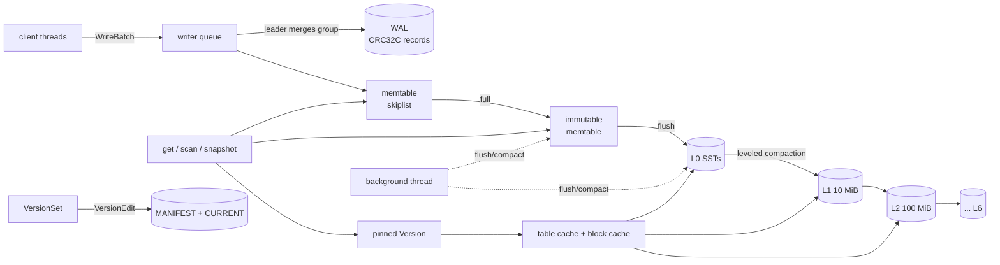

# lsmkv

[](https://github.com/SlateGitOrg/lsmkv/actions/workflows/ci.yml)

An LSM-tree key-value storage engine in Rust, built from first principles in
the LevelDB lineage: a checksummed write-ahead log with group commit, a
concurrent skiplist memtable, SSTables with prefix-compressed blocks, a block
index and bloom filters, leveled compaction, MVCC snapshots, range iterators
and a crash-safe manifest — plus a simulated filesystem that crashes the
engine at every single I/O operation to prove it recovers.

```rust
use lsmkv::{Db, Options, ReadOptions, WriteBatch, WriteOptions};

let db = Db::open("/tmp/mydb", Options::default())?;
db.put(b"user/42", b"alice")?;

let mut batch = WriteBatch::new();               // atomic, ordered
batch.put(b"user/43", b"bob").delete(b"user/42");
db.write(&WriteOptions { sync: true }, batch)?;   // fsynced before returning

let snap = db.snapshot();                         // repeatable reads
db.put(b"user/43", b"carol")?;
let old = ReadOptions { snapshot: Some(&snap), ..ReadOptions::default() };
assert_eq!(db.get_with(&old, b"user/43")?, Some(b"bob".to_vec()));

for kv in db.scan(&ReadOptions::default(), Some(b"user/"), Some(b"user0"))? {
    let (k, v) = kv?;                             // [start, end) range scan
}
```

## Why

Storage engines are where database correctness is actually decided: what
survives a power cut, what a snapshot sees, what a compaction may throw away.
lsmkv is a readable, tested reference implementation of those details: every
durability rule is written down
([docs/ARCHITECTURE.md](docs/ARCHITECTURE.md) §7) and enforced by a test that
crashes the engine. It is **not** a production database (see Limitations).

## Features

| Area | What is implemented |
|---|---|
| WAL | 32 KiB block framing, CRC-32C per fragment, torn-tail vs. mid-log corruption detection, group commit (one record + one fsync per group of writers) |
| Memtable | skiplist with lock-free readers (Acquire/Release publication), single serialised writer |
| SSTables | prefix compression with restart points, shortened index separators, whole-table bloom filter (10 bits/key), per-block checksums, LRU block cache, table cache |
| Compaction | leveled, size/count scoring, round-robin compaction pointers, trivial moves, grandparent-overlap output cuts, snapshot-aware version dropping, tombstone elision at the base level |
| MVCC | 56-bit sequence numbers, snapshots, iterators pinned to a version |
| Metadata | manifest of version edits, atomic `CURRENT` switch, manifest rollover, obsolete-file GC that respects pinned versions |
| Recovery | point-in-time WAL replay (default) or strict tail-only tolerance |
| Fault injection | `SimFs`: only fsynced bytes / dir-fsynced entries survive, crash at the N-th operation, torn writes with garbage, one-shot I/O errors |
| Tooling | `lsmkv` CLI, `db_bench` (fillseq, fillrandom, overwrite, readrandom, readseq, fillsync, fillsync_mt), amplification counters |

## Architecture



* **Write**: queue → leader → one WAL record per group (fsync if any writer
  asked) → memtable → publish sequence number.
* **Read**: memtable → immutable memtable → L0 newest-first → one table per
  level; bloom filter → index → (cached) block.
* **Background**: flush the immutable memtable to L0; otherwise compact the
  level with the highest score; delete files no live version references.

Deeper design, file formats, the crash-safety argument and a complexity
table: [docs/ARCHITECTURE.md](docs/ARCHITECTURE.md). Amplification analysis:
[docs/AMPLIFICATION.md](docs/AMPLIFICATION.md). Every judgment call:
[DECISIONS.md](DECISIONS.md).

## Quick start

Requires a Rust toolchain (`rust-version` is declared as 1.85; development used 1.97) and, for coverage,
`cargo-llvm-cov` (`cargo install cargo-llvm-cov`).

```sh
make check     # fmt-check, clippy -D warnings, rustdoc + check, all tests under coverage (>= 80%), doctests
make demo      # end-to-end tour (output below)
make bench     # 1M-entry db_bench run, writes bench/RESULTS.md

cargo run --release --bin lsmkv -- put  /tmp/db hello world
cargo run --release --bin lsmkv -- get  /tmp/db hello
cargo run --release --bin lsmkv -- load /tmp/db 100000
LSMKV_LOG=info cargo run --release --bin lsmkv -- compact /tmp/db
cargo run --release --bin lsmkv -- scan /tmp/db key000010 key000013
```

## Demo

`make demo` (`examples/demo.rs`) — real output from this machine. Parts 1–5
use the real filesystem in `./demo-data` (deleted afterwards); parts 6–7 use
the simulated filesystem to cut power on purpose.

```

== 1. Bulk load (real filesystem, background compaction) =================
loaded 100000 keys in random order: 1.66s (60328 keys/s)
L0:    3 files      1118657 bytes
L1:    5 files      1893853 bytes
L2:   16 files      8460882 bytes
flushes 31, compactions 17, trivial moves 6, write amplification 5.46 (WAL + tree), tree-only 4.44

== 2. Point reads and bloom filters ======================================
get key0000000 -> v1-0-.........…
get key0004242 -> v1-4242-......…
get key0099999 -> v1-99999-.....…
10000 lookups of absent keys: 10000 misses; 46026 table probes, bloom filters ruled out 45632 (99.1%)

== 3. MVCC snapshot isolation ============================================
took snapshot at sequence 100000
key0000005: latest = v2-5-.........…    snapshot = v1-5-.........…
key0001200: latest = (none)             snapshot = v1-1200-......…
live keys: latest 99500, snapshot 100000

== 4. Range scan [key0050000, key0050004) ================================
  key0050000 = v1-50000-.....…
  key0050001 = v1-50001-.....…
  key0050002 = v1-50002-.....…
  key0050003 = v1-50003-.....…

== 5. Full compaction and space amplification ============================
before: 23 tables, 11678816 bytes for 10945000 live bytes -> space amp 1.07
after:  22 tables, 11490133 bytes for 10945000 live bytes -> space amp 1.05
L3:   22 files     11490133 bytes
reopened: key0000077 = v2-77-........…

== 6. Power loss with torn writes (simulated filesystem) =================
1000 fsynced writes + 300 unsynced writes, then power loss tearing the WAL tail
all 1000 fsynced writes recovered: true
256 of 300 unsynced writes survived, forming a prefix of history: true

== 7. Kill mid-compaction at every filesystem operation ==================
6 multi-file compactions spanning 725 filesystem operations
crashed at each one, recovered, compared with a BTreeMap model: 725/725 consistent
```

## Testing: how correctness is established

`cargo test` runs 94 tests (`cargo test -q 2>&1 | grep "test result"`):

* **Crash-point enumeration** (`tests/crash_recovery.rs`). A workload is run
  once to count its mutating filesystem operations; then it is re-run once per
  operation index with `SimFs::crash_after(n)`, power is cut (unsynced bytes
  dropped, or torn with garbage), the database is reopened and compared with a
  `BTreeMap` model. With synced writes every acknowledged write must survive
  and nothing unacknowledged except the in-flight write may appear; with
  unsynced writes the state must be an exact prefix of history no shorter than
  the last synced write. Covers every operation of a 120-write workload (360
  crash points), **every operation inside 9 multi-file compactions** (770 crash
  points), torn WAL tails over 64 seeds, injected I/O errors of six kinds, and
  a sampled background-thread variant. After recovery no orphaned table may
  remain. (Crash-point counts are printed by
  `cargo test --test crash_recovery -- --nocapture`.)
* **Model-based property tests** (`tests/model_proptest.rs`). Random
  sequences of puts, deletes, batches, gets, range scans, snapshot
  create/read/scan/drop, flushes, full/partial compactions and reopens run
  against the engine and a `BTreeMap` (plus a frozen copy per live
  snapshot), in inline mode, background-thread mode, and a tiny-blocks /
  no-bloom / no-cache configuration.
* **Corruption** (`tests/corruption.rs`): bit flips in SST blocks surface as
  `Error::Corruption` (never wrong data); mid-WAL damage yields a prefix in
  point-in-time mode and refuses to open in strict mode; damaged manifest or
  `CURRENT` refuses to open.
* **Concurrency** (`tests/integration.rs`, real filesystem): three writers
  and two snapshot readers verify batch atomicity while background compaction
  runs; an iterator keeps reading its pinned version across a full compaction.
* **Unit tests** in every module (CRC-32C RFC 3720 vectors, LevelDB hash
  vectors, varints, skiplist under concurrent readers, block seek at every
  restart interval, bloom false-positive rate, LRU order, manifest recovery…).

The tests earned their keep: the background-mode property test found a real
resurrection bug — a compaction output could split one user key's versions
across two files, and a later compaction that moved only the newer file down
a level left the stale one shadowing it. Outputs are now cut only between user
keys and the level invariant checks user-key disjointness (see DECISIONS.md).
During development each of three fsyncs (compaction outputs, the new WAL's
directory entry, the old WAL at rotation) was deleted by hand in turn, and
each deletion made a crash test fail.

**Coverage**: `make coverage` reports **97.2–97.3% line coverage** of the library
(`src/`, excluding `src/bin/` and `examples/`; in-file `#[cfg(test)]`
modules are counted by llvm-cov; the figure moves slightly between runs
because background-thread tests take different paths) and fails below 80%.

## Benchmarks

`make bench` (`scripts/bench.sh` → `db_bench --num=1000000`), 16-byte keys,
100-byte incompressible values, default options, on an Apple M1 Pro / 16 GB /
APFS **while other builds were running on the same machine** (load average ≈ 7 on 8 cores) —
see [bench/RESULTS.md](bench/RESULTS.md) for the full environment:

```
lsmkv db_bench: keys 16 bytes, values 100 bytes, entries 1000000, db bench/tmp/db_bench
----------------------------------------------------------------------------------------------------
fillseq     :      3.927 micros/op;    28.2 MB/s  WA 2.19 (tree 1.00), 41 flushes, 0 compactions, stall 0.0s
fillrandom  :      5.578 micros/op;    19.8 MB/s  WA 5.60 (tree 4.41), 41 flushes, 44 compactions, stall 0.0s
overwrite   :      6.400 micros/op;    17.3 MB/s  WA 7.27 (tree 6.08), 41 flushes, 58 compactions, stall 0.0s
readrandom  :      4.707 micros/op;    20.3 MB/s  865482 of 1000000 found; 1.53 tables/get, 0.88 block reads/get, bloom saved 658673, cache hit 8%
readseq     :      0.161 micros/op;   687.5 MB/s  865047 live keys; space amplification 1.08 (108721399 table bytes / 100345452 live bytes)
fillsync    :   4028.584 micros/op;     0.0 MB/s  10000 fsyncs for 10000 writes
fillsync_mt :   1660.796 micros/op;     0.1 MB/s  4 threads; group commit: 10000 writes in 3977 WAL records, 3977 fsyncs (2.51 writes/fsync)
```

Reading it: random-order loading costs ~2.5× the write amplification of
sequential loading (5.60 vs 2.19) because sequential tables never overlap and
are trivially moved; bloom filters keep data-block reads at 0.88 per lookup
although 1.53 tables cover each key; a 1M-entry tree carries 8% space
overhead; concurrent sync writers share fsyncs (2.5 writes per fsync with 4
threads; `db_bench --num=100000 --benchmarks=fillsync_mt --threads=16`
reached 9.4 in a separate run). The fsync-bound rows
reflect APFS `fsync` latency (~4 ms here). There is no comparison against
LevelDB/RocksDB because none was run on this machine.

## Design decisions (summary)

* LevelDB-style formats and leveled compaction, reimplemented with no runtime
  dependencies except `log`.
* Stricter durability than LevelDB: the old WAL is fsynced on rotation and
  the directory is fsynced when a WAL is created, so history never has holes.
* Point-in-time WAL recovery by default; strict mode available.
* Compaction outputs never split a user key (bug found by property testing).
* Deterministic inline-compaction mode so every crash point is reproducible.

Full list with trade-offs: [DECISIONS.md](DECISIONS.md).

## Project layout

```
src/fs/         FileSystem trait, OsFs, SimFs (crash model + fault injection)
src/wal/        log format writer/reader (WAL and manifest)
src/memtable/   skiplist + memtable
src/sstable/    blocks, bloom filters, table builder/reader
src/version/    versions, version edits, version set + manifest
src/db/         Db: write path, reads, iterators, snapshots, background work
src/compaction.rs, key.rs, batch.rs, cache.rs, iterator.rs, stats.rs, ...
src/bin/        lsmkv CLI, db_bench
tests/          crash, property, corruption, integration tests
examples/demo.rs
```

Size (`scripts/loc.sh`): 7011 lines (5576 excluding blank and comment lines) of non-test Rust,
1950 lines of unit tests and 929 lines of integration tests.

## Limitations

* **Not production software.** No users, no deployments, no fuzzing campaign
  beyond the property tests; durability is proven against the simulator's
  model of POSIX, not against real disks.
* **macOS durability**: `sync` is `fsync` (`File::sync_data`), not
  `F_FULLFSYNC`, so on macOS acknowledged writes can be lost if the drive's
  write cache is volatile.
* **No compression**, no reverse iteration, no custom comparators, no column
  families, no merge operator, no TTL, no seek-triggered compactions.
* **Single process**: there is no `LOCK` file; two processes opening one
  directory will corrupt it.
* **One compaction at a time** on one background thread; large write bursts
  stall on L0 (`l0_stop_trigger`) instead of parallelising compactions.
* The manifest fsync happens under the database mutex, briefly blocking
  readers and writers once per flush/compaction.
* Point-in-time recovery silently (warn-logged) drops intact WAL records that
  follow a corrupted one.
* A whole-table bloom filter is held in memory for each open table.
* Benchmarks were taken on a loaded laptop; treat absolute throughput as a
  lower bound and compare ratios, not raw numbers.

## Roadmap

1. Snappy/LZ4 block compression (the format already reserves the type byte).
2. Reverse iteration (`prev`, `seek_for_prev`).
3. Parallel subcompactions and a separate flush thread.
4. Seek-triggered compactions and partitioned bloom filters.
5. A `LOCK` file and `F_FULLFSYNC` on macOS.
6. A repair tool that rebuilds a manifest from surviving tables.
7. Long-running randomized crash/fuzz campaigns (cargo-fuzz on the WAL and
   block decoders).

## License

MIT — see [LICENSE](LICENSE).
