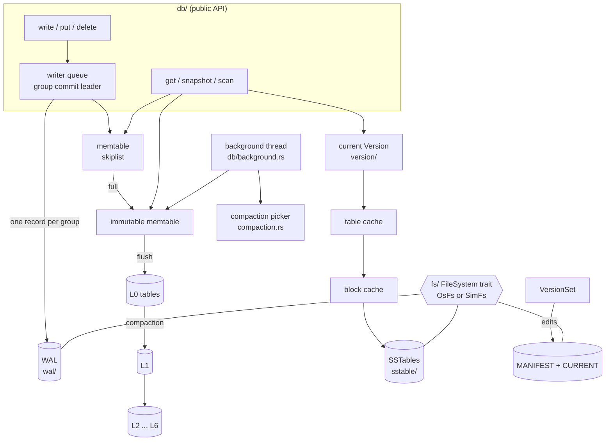

# lsmkv architecture

This document describes how lsmkv stores data, how each operation flows
through the engine, why the on-disk state is always recoverable, and what
each operation costs. Module paths refer to `src/`.

## 1. Component map



| Module | Responsibility |
|---|---|
| `fs` | `FileSystem` trait; `OsFs` (std::fs) and `SimFs` (in-memory, power-loss model, fault injection) |
| `util` | varint/fixed coding, CRC-32C, LevelDB hash, SplitMix64 RNG, CLI logger |
| `key` | internal key encoding and ordering, index separators |
| `batch` | `WriteBatch` encoding (also the WAL payload) |
| `memtable` | lock-free-reader skiplist and the memtable built on it |
| `wal` | block-framed, checksummed record log (used by WAL and manifest) |
| `sstable` | block builder/reader with prefix compression, bloom filters, table builder/reader, two-level iterator |
| `cache` | sharded LRU used for blocks and open tables |
| `iterator` | `InternalIterator` trait, k-way `MergingIterator` |
| `version` | `FileMetaData`, `Version`, `VersionEdit`, `VersionSet` + manifest, `LevelIter`, `TableCache` |
| `compaction` | scoring, input selection, grandparent-overlap cuts, drop rules helpers |
| `db` | open/recovery, group-commit write path, reads, snapshots, iterators, background work, file GC |
| `stats` | counters and amplification formulas |

## 2. Data model: internal keys and MVCC

Every write is stamped with a 56-bit sequence number. The engine stores
*internal keys*: `user_key ++ fixed64_le(seq << 8 | kind)` where `kind` is
`Value` (1) or `Deletion` (0). Internal keys sort by user key ascending, then
by the packed trailer **descending** — newest version first (`key.rs`).

Consequences:

* A point lookup at snapshot `s` seeks to `(key, s, Value)`; the first entry
  at or after that target with the same user key is the newest version visible
  at `s`. If it is a tombstone the key is absent.
* A scan merges all sources and keeps, for each user key, the first entry with
  `seq <= s`, hiding tombstones (`db/iter.rs`).
* A snapshot is only a sequence number registered in `SnapshotRegistry`;
  holding it prevents compaction from dropping versions it can see.

## 3. Write path (`db/mod.rs`)

1. `Db::write` wraps the batch in a `Writer` and appends it to a queue under the
   state mutex. Writers wait on a condition variable until they reach the head.
2. The head becomes the **leader**. It calls `make_room_for_write`, which may:
   delay the write 1 ms (L0 has `l0_slowdown_trigger` files), wait for the
   background flush (immutable memtable still pending, or L0 at
   `l0_stop_trigger`), or **switch memtables**: create WAL `n+1`, fsync the
   directory, fsync WAL `n`, install a fresh memtable, mark the old one
   immutable and wake the background thread.
3. The leader merges queued followers' batches into one batch (up to 1 MiB, or
   leader size + 128 KiB for small leaders), assigns consecutive sequence
   numbers, **releases the mutex**, appends one WAL record, fsyncs if any
   member asked for `sync`, and inserts the operations into the memtable.
4. It re-locks, publishes `last_sequence` (readers never see a half-applied
   batch, because they read at `last_sequence`), pops the group and wakes the
   followers with the shared result.

With *T* concurrent sync writers, one fsync covers up to *T* writes: the
benchmark's `fillsync_mt` row reports the measured writes per fsync.

**Skiplist memtable** (`memtable/skiplist.rs`): towers of height ≤ 12 with
branching factor 4. Inserts are serialised by a mutex; readers are lock-free.
A node is fully initialised before a `Release` store links it at each level,
and readers traverse with `Acquire` loads, so any node a reader can reach is
complete. Nodes are never removed while the list is alive, so no
reclamation scheme is needed; iterators hold an `Arc` to the list.

## 4. Read path

`get`: clone `Arc`s of the memtable, immutable memtable and current version
under the mutex, then search without it: memtable → immutable memtable → L0
files newest-first (every L0 file whose range covers the key) → one file per
level L1..L6 (binary search on the files' largest keys). For each candidate
table: bloom filter → index block binary search → data block (block cache,
else read + CRC check) → restart-point binary search + scan.

Scans build a `MergingIterator` (binary heap, `O(log k)` per step) over the
memtables, one `TableIter` per L0 file and one `LevelIter` per deeper level
(which opens tables lazily). The `DbIterator` pins the `Version`, so files it
reads are not deleted until it is dropped.

## 5. File formats

### WAL and manifest (`wal/`)

32 KiB blocks of fragments: `masked crc32c (4) | length (2) | type (1) | payload`.
Types FULL/FIRST/MIDDLE/LAST split records larger than a block's remainder;
block tails shorter than a header are zero-padded. The reader classifies
problems as **truncated tail** (file ends mid-fragment or mid-record) or
**corruption** (bad checksum/type/length or broken fragment sequence; it
resynchronises at the next block). `any_record_follows()` distinguishes damage
at the tail (a torn write) from damage followed by valid data (media
corruption).

WAL record payload = `WriteBatch` encoding:
`seq fixed64 | count fixed32 | (kind u8, varint key, [varint value])*`.

### SSTable (`sstable/`)

```
data block 0 | trailer      ┐
...                          │ trailer = compression byte (0) + masked crc32c
data block n | trailer      ┘
filter block | trailer        bloom filter over user keys, k probes, last byte = k
metaindex    | trailer        "filter.bloom" -> handle
index block  | trailer        separator >= last key of block i -> handle(i)
footer (48 B)                 metaindex handle, index handle, padding, magic
```

Blocks: entries `shared | unshared | value_len | key_delta | value` with a
restart point (full key) every 16 entries and the restart offset array at the
end. Index separators are shortened (`abcd…` / `abzz…` → `abd`), keeping the
index small.

### Manifest records (`version/edit.rs`)

Tagged fields: log number, next file number, last sequence, compaction
pointers, deleted files `(level, number)`, new files
`(level, number, size, smallest, largest)`. A new manifest starts with a
snapshot edit of the full current state. `CURRENT` holds `MANIFEST-NNNNNN\n`.

## 6. Leveled compaction (`compaction.rs`, `db/background.rs`)

* **Score**: L0 = files / `l0_compaction_trigger` (4); level *n* ≥ 1 =
  bytes / (`max_bytes_for_level_base` · `level_multiplier`^(n−1)) (10 MiB, ×10).
  The highest score ≥ 1 is compacted next. Flushes always take priority.
* **Inputs**: L0 — every L0 file overlapping the first file, transitively.
  Ln — the first file after the level's round-robin compaction pointer. Add all
  overlapping files of L(n+1); grow the Ln set if that adds no L(n+1) file and
  stays under 25 × `max_file_size`.
* **Trivial move**: one input, nothing overlapping below, small grandparent
  overlap → re-parent the file with a manifest edit, no I/O.
* **Merge**: k-way merge of the inputs. For each user key, track the sequence
  of the previous (newer) entry. An entry is dropped if
  1. a newer entry of the same key has `seq <= smallest_snapshot` (no snapshot
     can see this one), or
  2. it is a tombstone with `seq <= smallest_snapshot` and no level below the
     output level has a file whose range contains the key
     (`is_base_level_for_key`).
* **Output cuts**: at `max_file_size`, or when the current output overlaps
  more than 10 × `max_file_size` of grandparent (L(n+2)) bytes — but only
  **between user keys**, so no user key straddles two files of a level (see
  DECISIONS.md for the bug this prevents).
* **Commit**: fsync each output, fsync the directory, then a manifest edit that
  deletes the inputs and adds the outputs. Files that no live version
  references are deleted afterwards.

## 7. Crash safety argument

The simulator (`fs/sim.rs`) implements the pessimistic POSIX model: only
fsynced bytes survive, and creations/renames/removals survive only after a
directory fsync. Against that model the engine maintains:

| Invariant | Mechanism |
|---|---|
| An acknowledged `sync` write survives | WAL record fsynced before ack; WAL directory entry fsynced at WAL creation |
| No hole in history (prefix property) | old WAL fsynced before the new WAL accepts writes; recovery stops at the first damaged record and discards later WALs |
| The manifest never references a missing/partial table | table fsync → directory fsync → manifest record fsync |
| A metadata change is all-or-nothing | one manifest record per change; a torn final record is ignored |
| Switching manifests is atomic | new manifest fully fsynced, then CURRENT replaced via temp+fsync+rename+dir fsync; old manifest deleted only afterwards |
| Orphans from interrupted flushes/compactions are harmless | not referenced by the manifest; deleted by the next file GC |

Recovery (`DbInner::recover_logs`): read `CURRENT` → replay the manifest →
replay WALs with number ≥ the manifest's log number into a memtable (flushing
to L0 when it fills) → write the remainder to L0 → create a new WAL → commit a
fresh manifest → delete obsolete files.

`tests/crash_recovery.rs` checks these invariants by crashing at **every**
mutating filesystem operation of a workload (and every operation inside
multi-file compactions), with both drop-unsynced and torn-write power loss.

## 8. Complexity

*N* = entries in the tree, *B* = entries per block, *r* = restart interval,
*L* = levels (≈ log₁₀ of data size / L1 size), *k* = L0 files, *F* = fan-out.

| Operation | Cost |
|---|---|
| Write (amortised, CPU) | `O(log M)` skiplist insert (*M* = memtable entries) + WAL append |
| Write (amortised, I/O) | WA ≈ 1 (WAL) + 1 (flush) + ~*F*/2 per level crossed — see `docs/AMPLIFICATION.md` |
| Point lookup | `O(log M)` memtables + up to `k + L` tables; per table: bloom `O(1)`, index `O(log(N_t/B))`, block `O(log(B/r) + r)` |
| Point lookup, I/O | ≈ 1 data-block read for present keys; ≈ `(k+L)·fp` for absent keys (fp ≈ 1% at 10 bits/key) |
| Seek + scan of *m* keys | `O((k+L) · log)` to seek, then `O(log(k+L))` per entry plus versions skipped |
| Compaction | streaming merge, `O(n log s)` for *n* input entries from *s* sources, `O(block)` memory per source |
| Recovery | `O(WAL bytes + manifest bytes)` |
| Memory | memtable (`write_buffer_size`, up to 2× during flush) + block cache + one index and filter per open table |
